# Matwona Smart Order 🐟🍜

Sistem pemesanan digital berbasis QR meja untuk **Matwona** — rumah makan spesialis olahan tuna segar kualitas ekspor dan ayam kampung gurih dengan dapur terbuka di Bandung.

Mencakup alur lengkap: **Landing page editorial, pemesanan meja via QR, buku menu digital & fotografi autentik, keranjang interaktif & catatan kustom, checkout mandiri (Kasir & QRIS), pelacakan pesanan realtime, dashboard operasional kasir & dapur, sinkronisasi Olsera POS, mesin rekomendasi AI (FP-Growth), dan analitik omzet.**

Proyek Computing Project (CAK4CAC3), S-1 Informatika, Telkom University, 2026.

---

## 📸 Tampilan Antarmuka (Design Showcase)

### 1. Landing Page Editorial

Tampilan landing page resto bergaya editorial modern (*Two worlds. One table. Simply, makan.*) dengan palet Matwona Deep Green (`#106F4D`) dan Warm Cream (`#FFFFCA`), menyajikan narasi dapur terbuka, daftar menu ringkas, dan akses instan scan QR demo.

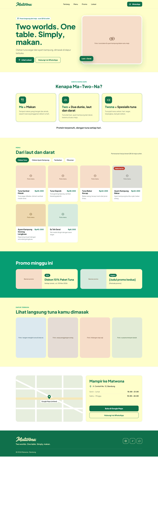

<div align="center">
  
</div>

---

### 2. Design System & Identitas Visual

Fondasi desain terpadu dengan standar aksesibilitas kontras tinggi (WCAG AA/AAA), palet warna alam laut & rempah, serta tipografi editorial yang rapi.

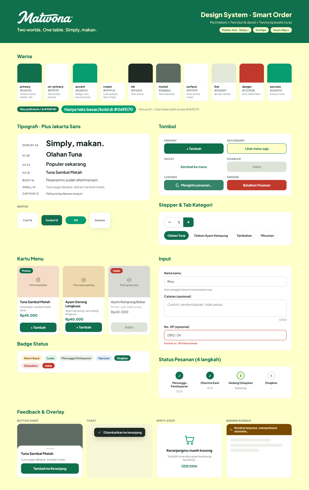

---

### 3. Alur Pemesanan Meja Pelanggan (Scan QR ➔ Selesai)

Alur pemesanan digital mandiri dari meja tanpa aplikasi, cukup scan QR code di atas meja:

| 1. Buku Menu Digital | 2. Detail & Catatan Kustom | 3. Keranjang & Rekomendasi AI |
| :---: | :---: | :---: |
| 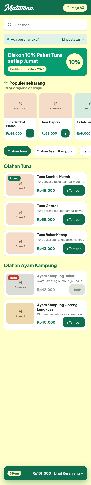 | 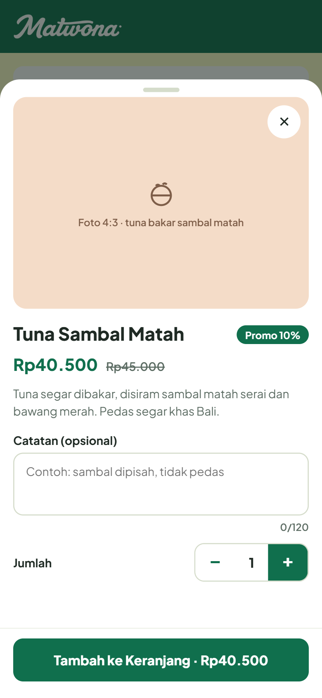 | 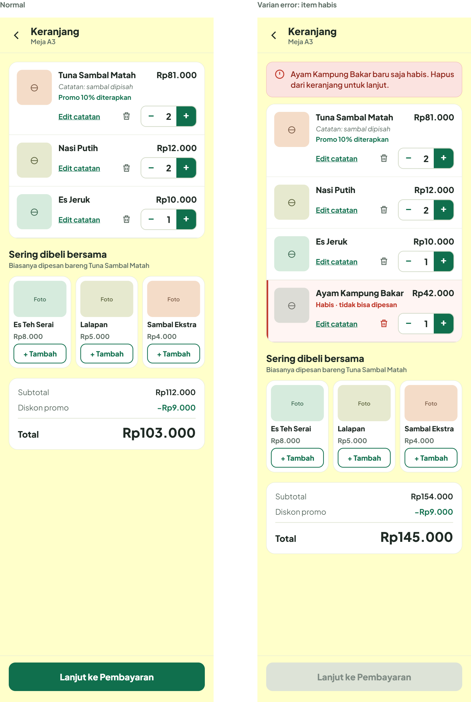 |
| Filter kategori, foto makanan 4:3, & tombol tambah instan | Resolusi tinggi, stepper porsi, & catatan bebas (sambal dipisah) | Rekomendasi menu pendamping (*cross-selling*) otomatis |

| 4. Konfirmasi Checkout | 5. Pembayaran QRIS Dinamis | 6. Pelacakan Pesanan Realtime |
| :---: | :---: | :---: |
| 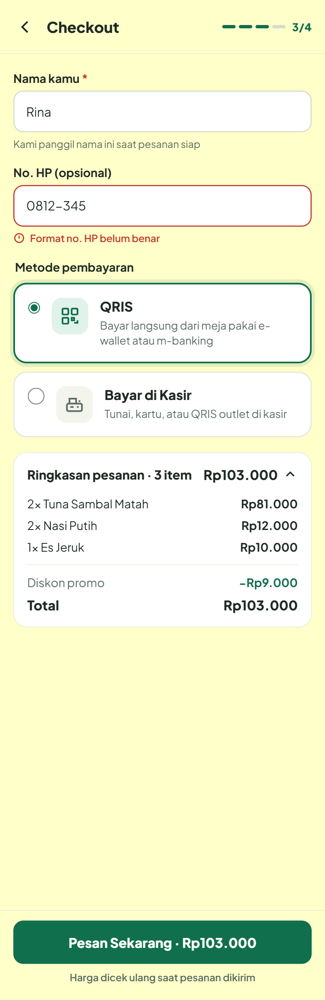 | 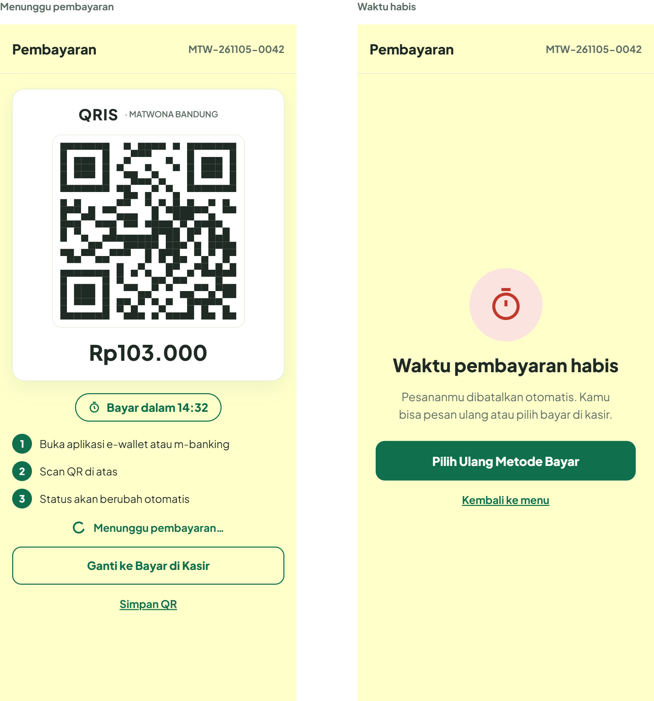 | 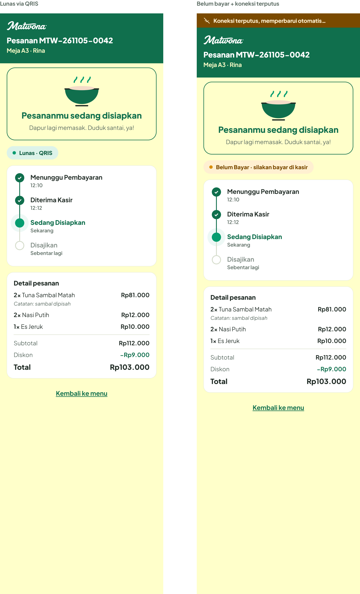 |
| Konfirmasi nomor meja & pilihan Bayar Kasir / QRIS | Kode QRIS instan dengan countdown batas waktu bayar | Status live: *Baru ➔ Diproses ➔ Disajikan ➔ Selesai* |

---

### 4. Portal Kasir & Dapur Operasional

Dashboard kasir kanban realtime dengan pembaruan instan berbasis WebSocket, notifikasi audio pesanan baru, dan dukungan cetak struk thermal 58mm / 80mm.

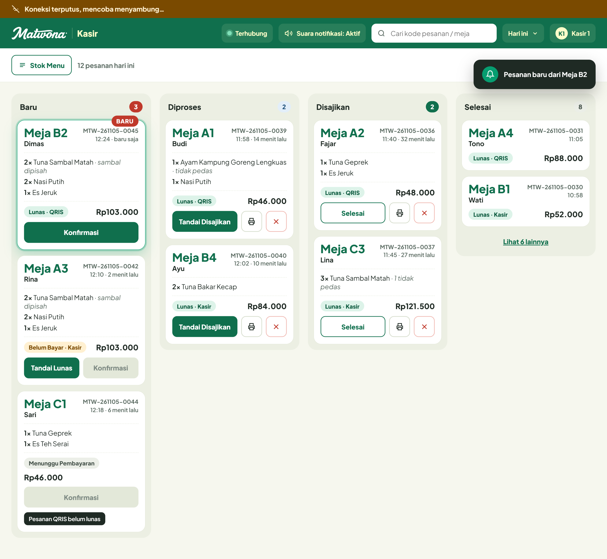

---

### 5. Portal Admin & Analitik Penjualan

Portal manajemen komprehensif bagi pemilik restoran untuk mengendalikan operasional secara terpusat:

| Analitik Penjualan & Omzet | Rekomendasi Menu AI (FP-Growth) |
| :---: | :---: |
| 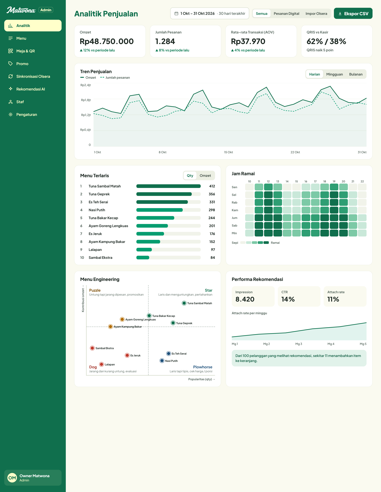 | 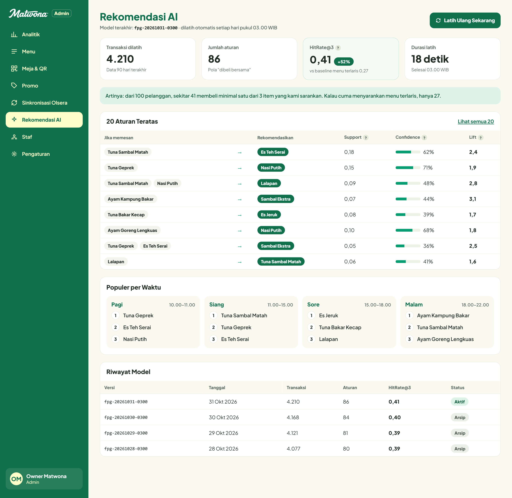 |
| Pantauan omzet harian, *average order value*, & jam sibuk | Metrik akurasi (*HitRate@3, Lift*) & pasangan menu terfavorit |

| Manajemen Katalog & Ketersediaan Stok | Sinkronisasi Olsera POS |
| :---: | :---: |
| 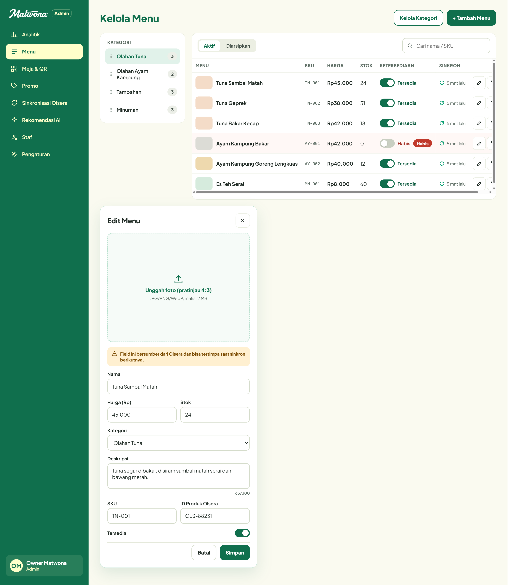 | 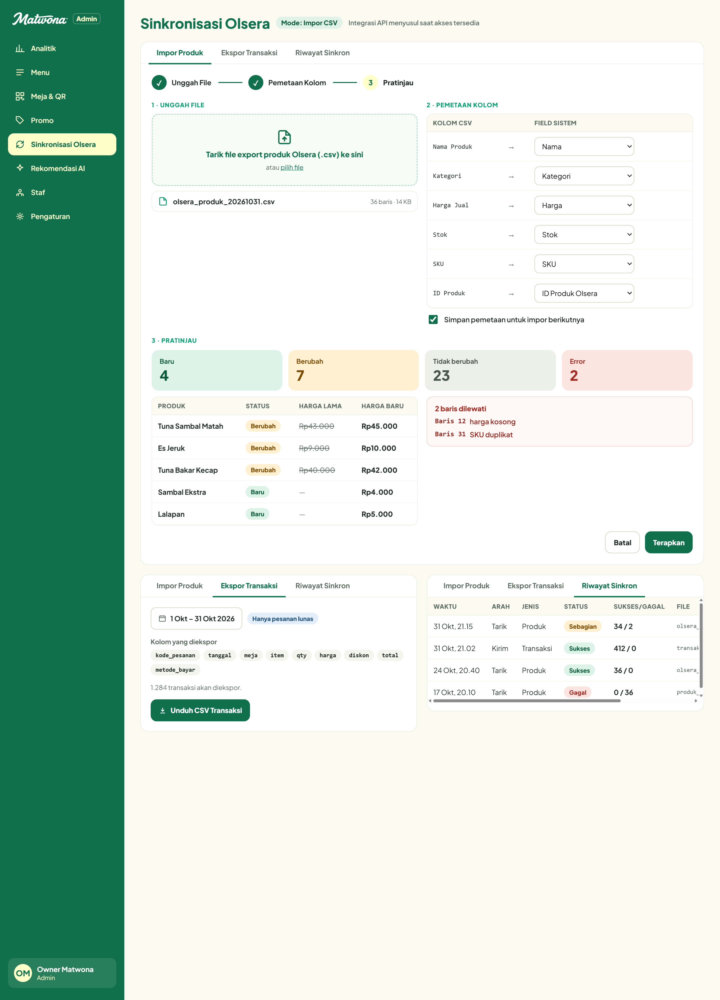 |
| Kelola harga, SKU, kategori, dan toggle status *Habis* | Impor menu & ekspor rekapitulasi penjualan CSV Olsera |

---

## 🎨 Brand & Design System

Aplikasi dirancang dengan pendekatan **Editorial Classic Restaurant Aesthetic** (*anti-slop, human-crafted, tactile & clean*):

- **Palet Warna Utama**:
  - `Matwona Deep Green` (`#106F4D`): Karakter laut & kesegaran bumbu alami, digunakan untuk navigasi, aksen utama, dan tombol aksi penting.
  - `Matwona Warm Cream` (`#FFFFCA`): Nuansa hangat, ramah, dan bersahabat sebagai latar belakang kanvas terpadu.
  - `Dark Ink` (`#1F2A24`): Tipografi tajam dengan kontras tinggi untuk keterbacaan menu di layar HP.
  - `Parchment White` (`#FFFFFF`): Lembar buku menu editorial putih bersih dengan sudut lengkung halus.
- **Tipografi**: Kombinasi font editorial serif yang berkarakter untuk judul naratif dan sans-serif geometris yang bersih untuk nama hidangan, deskripsi, dan harga resmi.
- **Fotografi Asli**: Menghilangkan seluruh emotikon generik/AI slop dan menggantinya dengan foto makanan asli berlisensi (olahan tuna, bakmie, nasi telur barendo krispi, ayam kampung, camilan risol, dan minuman dingin segar).

---

## 📱 Ringkasan Fitur Utama

```
[ Landing Page ] ➔ [ Scan QR Meja ] ➔ [ Menu Digital & Foto ] ➔ [ Detail & Catatan ]
                                                                       │
[ Pelacakan Realtime ] 🠔 [ Checkout & Pembayaran ] 🠔 [ Floating Cart Sheet ]
```

1. **Landing Page Editorial (`/`)**: Narasi utama, jam operasional, alamat di Bandung, 4 pilar dapur terbuka, dan akses langsung ke demo meja.
2. **Menu Digital Meja (`/m/matwona/t/<qrToken>`)**: Token QR acak 128-bit base62 kriptografis (contoh demo: `/m/matwona/t/tok-meja-01` untuk Meja 1).
3. **Detail Menu & Catatan Kustom (`MenuDetailSheet`)**: Foto hidangan resolusi tinggi, input catatan (*"sambal dipisah"*), dan stepper porsi.
4. **Keranjang Belanja Floating (`CartSheet`)**: Floating bar responsif dengan ringkasan total harga dan item.
5. **Checkout Mandiri (`/m/matwona/t/<qrToken>/checkout`)**: Input nama pemesan, konfirmasi meja, dan pilihan metode bayar (Kasir / QRIS).
6. **Pelacakan Realtime (`/m/matwona/order/<orderCode>`)**: Status sajian *Baru ➔ Diproses ➔ Disajikan ➔ Selesai* via WebSocket.
7. **Dashboard Kasir Kanban (`/cashier`)**: Manajemen alur pesanan, filter meja, cetak struk thermal, dan pembatalan pesanan.
8. **Admin Panel Lengkap (`/admin`)**: Analitik penjualan, manajemen menu & stok, kupon promo, akun staf, sinkronisasi Olsera POS, dan monitoring rekomendasi AI.

---

## 🏗️ Arsitektur & Teknologi

```
matwona-smart-order/
├── apps/
│   ├── web/        Next.js 16 (App Router, React 19, Tailwind CSS v4, Lucide Icons)
│   ├── api/        NestJS 11 (REST API, WebSocket Gateway, Prisma ORM, Redis Cache & Pub/Sub)
│   └── reco/       FastAPI (Python 3.12, Mlxtend FP-Growth, Uvicorn)
├── packages/
│   └── shared/     Skema Zod, tipe TypeScript bersama, konstanta status & harga
├── infra/          PostgreSQL 14 & Redis
└── docs/           PRD, Backlog, Desain, Dokumen ComPro, & Screenshots
```

---

## 🚀 Menjalankan Secara Lokal

### Prasyarat
- Node.js 22 LTS + pnpm (`corepack enable`)
- PostgreSQL 14 & Redis (via WSL atau Docker)
- Python 3.12 + [uv](https://docs.astral.sh/uv/) (untuk service rekomendasi AI)

### Langkah Instalasi
```bash
# 1. Klon repositori & salin konfigurasi env
cp .env.example .env

# 2. Pasang dependensi monorepo
corepack enable
pnpm install

# 3. Migrasi & Seed Database
pnpm db:migrate
pnpm db:seed

# 4. Jalankan Server Pengembangan (Web di port 3000, API di port 4000)
pnpm dev

# 5. Jalankan Service Rekomendasi Menu (Terminal Baru)
cd apps/reco
uv sync
uv run fastapi dev app/main.py --port 8000
```

### URL Akses Lokal
| Halaman | URL | Keterangan |
|---|---|---|
| **Landing Page** | `http://localhost:3000` | Sajian editorial, jam buka, dan info resto |
| **Demo Menu Meja 1** | `http://localhost:3000/m/matwona/t/tok-meja-01` | Menu digital lengkap dengan foto & checkout |
| **Portal Kasir** | `http://localhost:3000/cashier` | Login: `kasir@matwona.local` / `Kasir123!` |
| **Portal Admin** | `http://localhost:3000/admin/analytics` | Login: `admin@matwona.local` / `Admin123!` |
| **API Backend** | `http://localhost:4000/api` | REST Endpoints & WebSocket `/realtime` |
| **Service Reco** | `http://localhost:8000/docs` | Dokumentasi OpenAPI FP-Growth |

---

## 🧪 Pengujian & Kualitas Kode

Aplikasi diuji secara komprehensif dengan cakupan 100% passing tests:
- **`apps/web`**: 18 test suite (197 unit & component tests passing).
- **`apps/api`**: 16 test suite (149 integration & unit tests passing).
- **`apps/reco`**: 4 algorithmic & API tests passing.

Jalankan pengujian:
```bash
pnpm --filter web test      # Menjalankan pengujian frontend (197 tests)
pnpm --filter api test      # Menjalankan pengujian backend (149 tests)
cd apps/reco && uv run pytest  # Menjalankan pengujian model AI (4 tests)
```

---

## 📄 Lisensi & Hak Cipta
© 2026 Matwona Kitchen Bandung & Tim Computing Project S-1 Informatika, Telkom University.  
Aset foto berlisensi via Wikimedia Commons (CC BY-SA 4.0 / CC BY-SA 3.0 / CC0 / Public Domain) & Matwona Kitchen Studio.
