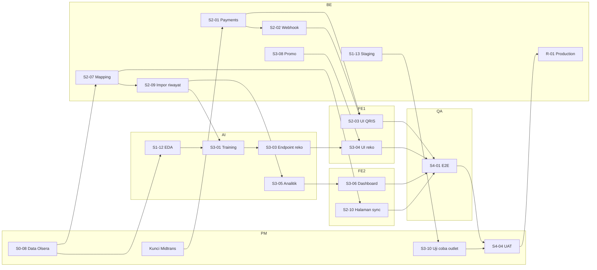

# Pembagian Tugas Tim — Matwona Smart Order

Dokumen ini membagi semua task yang **belum selesai** di [`BACKLOG.md`](BACKLOG.md) ke 7 peran tim (PRD Lampiran C), lalu menjelaskan alur serah-terima (*handoff*) antarperan.

- **Posisi saat ini:** minggu 9 (MVP Review), sesuai asumsi PRD Lampiran B (minggu 7 = 30 Oktober 2026).
- **Progres backlog:** 21 dari 56 task selesai (38%).
- **Dasar status:** pengecekan kode di branch `fajri` per 13 November 2026. Beberapa task sudah ada kodenya tapi belum dicentang; ini ditandai *"sebagian"* atau *"verifikasi"*.

Kalau backlog berubah, perbarui dokumen ini juga.

---

## 1. Anggota dan Peran

Isi kolom nama sesuai hasil pembagian dari dosen kelas.

| Kode | Peran | Nama | Area utama |
|------|-------|------|------------|
| **PM** | Project Manager & Business Analyst | _Rizky Saputra_ | Koordinasi sprint, mitra, Olsera, Midtrans, business plan |
| **SA** | System Analyst | _Deven Febrian_ | BRS, SRS, SDD, traceability, user guide |
| **FE1** | UI/UX Designer & Front-end Developer | _Muhammad Fajri_ | Landing page, menu digital, checkout, pembayaran, rekomendasi di sisi pelanggan |
| **FE2** | Front-end Developer | _Taura Muhammad_ | Dashboard kasir & admin, grafik analitik |
| **BE** | Back-end Developer | _Irham Muhammad_ | `apps/api`, `infra`, payments, pos-sync, deployment |
| **AI** | AI/ML & Data Engineer | _Muhammad Andhika_ | `apps/reco`, EDA, model, `modules/analytics` |
| **QA** | System Tester & Marketing Specialist | _Muhammad Naufal_ | Test plan, E2E, performa, keamanan, UAT, poster & video |

---

## 2. Jobdesc per Peran

Kolom **Terima dari** berisi hal yang harus siap sebelum task dimulai. Kolom **Serahkan ke** berisi siapa yang melanjutkan setelah task selesai.

### PM — Project Manager & Business Analyst

| ID | Task | Minggu | Terima dari | Serahkan ke | Kondisi sekarang |
|----|------|:------:|-------------|-------------|------------------|
| S0-08 | Minta contoh export produk & transaksi Olsera, konfirmasi akses API, simpan bukti | 9 (**mendesak**) | Mitra | BE (S2-07, S2-09), AI (S1-12) | Belum. Memblokir seluruh rantai AI. |
| – | Daftar akun Midtrans sandbox, serahkan `SERVER_KEY`/`CLIENT_KEY` sandbox lewat kanal aman (bukan commit) | 9 | – | BE (S2-01) | Belum |
| S1-14 | Slide progres penilaian minggu 9 (bersama SA) | 9 | SA (SDD), BE (demo staging) | Dosen | `PROGRESS-W9.md` masih kerangka |
| S0-07 | Notulen validasi mitra untuk BRS/SRS | 9–10 | Mitra | SA | Notulen belum terisi di `LOGBOOK.md` |
| S3-10 | Uji coba di outlet Matwona (jadwal, izin, QR tercetak) bersama QA | 13 | FE2/BE (PDF QR), BE (staging stabil) | QA (S4-04) | Belum |
| S4-04 | UAT bersama mitra + kuesioner SUS (bersama QA) | 14 | QA (skenario UAT) | Semua dev (perbaikan bug) | Belum |
| S4-06 | Business plan / go-to-market final | 12–14 | AI (data analitik untuk argumen bisnis) | Dosen | Belum |
| R-02 | Final presentation & demo | 15 | Semua | Dosen | Belum |
| R-03 | Exhibition: booth, QR contoh, dashboard, poster, video | 16 | QA (poster, video), BE (production) | – | Belum |
| – | Rekap logbook & kontribusi individu tiap minggu | tiap minggu | Semua anggota | Dosen | Tabel kontribusi masih kosong |

### SA — System Analyst

| ID | Task | Minggu | Terima dari | Serahkan ke | Kondisi sekarang |
|----|------|:------:|-------------|-------------|------------------|
| S1-14 | SDD draft untuk penilaian minggu 9 | 9 (**mendesak**) | BE, AI (arsitektur, ERD dari `schema.prisma`) | PM (slide) | `SDD.md` v0.1 sudah ada, perlu difinalkan |
| S0-07 | Finalisasi BRS & SRS | 9–10 | PM (notulen mitra) | Semua (acuan FR) | Masih berstatus "Draft" |
| – | Matriks traceability FR → task → test, diperbarui tiap akhir sprint | 11, 13, 14 | Dev (PR), QA (test case) | QA, PM | Belum |
| – | Update SDD: sequence diagram pembayaran QRIS & alur sinkronisasi Olsera | 11 | BE (S2-01, S2-02, S2-07) | PM (progress report) | Belum |
| – | Laporan evaluasi model (bersama AI) | 13 | AI (S3-02) | PM (progress report) | Belum |
| S4-05 | User guide pelanggan, kasir, admin di `docs/user-guide/` (bersama QA) | 13–14 | FE1, FE2 (screenshot halaman final) | QA, mitra | Folder belum ada |

### FE1 — UI/UX Designer & Front-end Developer

| ID | Task | Minggu | Terima dari | Serahkan ke | Kondisi sekarang |
|----|------|:------:|-------------|-------------|------------------|
| S2-06 | Landing page: lengkapi `metadata`, SEO, schema.org `Restaurant`, SSG/ISR | 9–10 | BE (menu publik sudah ada) | QA (Lighthouse S4-02) | **Sebagian.** Konten sudah ada; SEO & schema.org belum. |
| S2-03 | UI pembayaran QRIS (Snap.js) + pilih ulang metode saat gagal | 10–11 | BE (kontrak `POST /public/orders/:code/pay` di `docs/API.md`) | QA (test pembayaran) | Opsi QRIS masih `disabled` di checkout |
| – | Halaman status pesanan bereaksi ke event `payment.updated` | 11 | BE (S2-02) | QA | Belum |
| S3-04 | UI "Populer sekarang" & "Sering dibeli bersama" + kirim `recommendation_events` | 12–13 | AI+BE (S3-03 endpoint final) | AI (S3-07 data CTR) | **Sebagian.** `cart-sheet` sudah memanggil rekomendasi; pencatatan event belum. |
| – | Tampilkan diskon promo di keranjang & checkout | 12–13 | BE (S3-08 harga + diskon dari server) | QA | Belum |
| S4-07 | Aset visual untuk poster & video (bersama QA) | 14 | – | QA | Belum |

### FE2 — Front-end Developer

| ID | Task | Minggu | Terima dari | Serahkan ke | Kondisi sekarang |
|----|------|:------:|-------------|-------------|------------------|
| S2-12 | Kelola akun staf (verifikasi + test, lalu centang) | 9–10 | BE (modul `staff` sudah ada) | QA | **Verifikasi.** Halaman & modul sudah ada. |
| S4-08 | Cetak struk 58/80 mm (verifikasi print CSS, lalu centang) | 9–10 | – | QA | **Verifikasi.** `thermal-receipt.tsx` sudah ada. |
| S2-10 | Halaman sinkronisasi: tambah UI pemetaan kolom tersimpan | 10–11 | BE (S2-07 endpoint mapping) | QA (E2E impor CSV) | **Sebagian.** Unggah, pratinjau, log, ekspor sudah memanggil API. |
| – | Badge "Lunas (QRIS)" otomatis di dashboard kasir saat `payment.updated` | 11 | BE (S2-02) | QA | Belum |
| S3-06 | Dashboard analitik: grafik Recharts, palet brand, filter tanggal & sumber | 12–13 | AI (S3-05 endpoint) | QA, PM (bahan business plan) | **Sebagian.** Filter tanggal sudah ada; grafik belum (Recharts terpasang tapi belum dipakai). |
| S3-07 | Halaman performa rekomendasi (impression, CTR, attach rate) + rule & model (bersama AI) | 13 | AI (endpoint performa) | QA | **Sebagian.** Halaman rule & model status sudah ada. |
| S3-08 | Halaman promo admin: sesuaikan dengan aturan penerapan dari BE | 12 | BE (S3-08) | QA | **Sebagian.** CRUD promo sudah ada. |

### BE — Back-end Developer

| ID | Task | Minggu | Terima dari | Serahkan ke | Kondisi sekarang |
|----|------|:------:|-------------|-------------|------------------|
| S1-13 | Deploy staging (Vercel + Cloud Run + DB) dan demo MVP | 9 (**mendesak**) | – | QA (smoke test), PM (demo) | Belum ada config deploy |
| S2-01 | Modul `payments`: `POST /public/orders/:code/pay`, Snap QRIS, expiry 15 menit | 10 | PM (kunci sandbox) | FE1 (S2-03) | **Belum ada sama sekali** |
| S2-02 | Webhook Midtrans: signature SHA512, idempoten, emit `payment.updated`, kembalikan stok saat expire | 10–11 | S2-01 | FE1, FE2 (UI realtime), QA | Belum |
| S2-07 | Simpan pemetaan kolom (`pos_column_mappings`) | 10–11 | PM (contoh file asli S0-08) | FE2 (S2-10) | **Sebagian.** Adapter, preview, apply, test sudah ada. |
| S2-08 | Ekspor CSV + log + `MockOlseraAdapter`: lengkapi test, lalu centang | 10 | – | FE2, QA | **Verifikasi.** Kode sudah ada. |
| S2-09 | Impor riwayat transaksi (`source = OLSERA_IMPORT`) (bersama AI) | 11 | PM (S0-08), S2-07 | AI (S3-01, S3-05) | Belum |
| S3-03 | Proxy rekomendasi: URL `reco` dari env, timeout **300 ms** (NFR-020), fallback terlaris, rute `GET /public/recommendations` | 12 | AI (`/internal/recommend` final) | FE1 (S3-04) | **Sebagian.** Proxy ada, tapi URL tertulis langsung di kode dan timeout 1500 ms. |
| S3-08 | Terapkan promo otomatis di `order-pricing.ts` (harga tetap dihitung server) | 12 | – | FE1, FE2 | **Sebagian.** CRUD ada; belum diterapkan saat checkout. |
| – | Catat semua endpoint baru di `docs/API.md` | tiap PR | – | SA, FE1, FE2 | Endpoint analytics, promos, staff, recommendations masih ⬜ |
| S4-02 | Uji performa k6 (bersama QA) | 14 | QA (skrip k6) | QA | Belum |
| S4-03 | Perbaikan temuan OWASP ZAP & `pnpm audit` (bersama QA) | 14 | QA (laporan temuan) | QA (retest) | Belum |
| R-01 | Deploy production, `min-instances=1`, warm-up | 15 | QA (UAT lulus) | PM (R-02) | Belum |

### AI — AI/ML & Data Engineer

| ID | Task | Minggu | Terima dari | Serahkan ke | Kondisi sekarang |
|----|------|:------:|-------------|-------------|------------------|
| – | Rapikan `apps/reco/app/main.py`: blok import & `app` terduplikasi (sisa merge), kemungkinan bikin `ruff check` di CI gagal | 9 (**cepat**) | – | BE (CI hijau) | Perlu diperbaiki |
| S1-12 | EDA data transaksi Olsera + PoC FP-Growth di notebook | 9–10 | PM (S0-08) | SA (SDD), PM (slide) | Folder `notebooks/` baru berisi README |
| S2-09 | Impor riwayat transaksi (bersama BE): validasi kualitas data | 11 | BE | – | Belum |
| S3-01 | Training FP-Growth nyata dari DB, simpan `recommendation_rules` & `recommendation_models` | 12 | S2-09 | BE (S3-03) | **Masih palsu:** rules & metrik tertulis langsung di `main.py`. Jangan dipakai sebagai hasil di laporan. |
| S3-02 | Evaluasi holdout: HitRate@3, Precision@3, coverage vs baseline | 12–13 | S3-01 | SA (laporan evaluasi) | Belum |
| S3-03 | `GET /internal/recommend` membaca rule dari DB (bersama BE) | 12 | S3-01 | BE (proxy) | **Sebagian** (endpoint ada, data statis) |
| S3-05 | Modul `analytics`: sales-trend, top-items, peak-hours, menu-engineering, export | 12 | S2-09 | FE2 (S3-06) | **Sebagian.** Baru ada `summary`. |
| S3-07 | Endpoint performa rekomendasi (impression, CTR, attach rate) | 13 | FE1 (S3-04 event tercatat) | FE2 | Belum |
| S3-09 | Cloud Scheduler retrain harian 03:00 WIB | 13 | S3-01, BE (staging) | – | Belum |

### QA — System Tester & Marketing Specialist

| ID | Task | Minggu | Terima dari | Serahkan ke | Kondisi sekarang |
|----|------|:------:|-------------|-------------|------------------|
| – | Smoke test staging untuk demo MVP | 9 | BE (S1-13) | PM | Belum |
| – | Test plan & test case per FR (mulai dari pembayaran dan sinkronisasi) | 10–11 | SA (SRS), BE (kontrak API) | Dev (laporan defect) | `UAT.md` masih draft |
| S4-01 | E2E Playwright: pelanggan → kasir, impor CSV admin (setup mulai minggu 11) | 11–14 | FE1, FE2, BE (fitur selesai) | Dev (defect) | Belum ada Playwright |
| S3-10 | Uji coba di outlet (bersama PM): catat temuan lapangan | 13 | PM | Dev, SA | Belum |
| S4-02 | k6 (50 pengguna) & Lighthouse (menu, landing) | 14 | BE (staging) | BE | Belum |
| S4-03 | OWASP ZAP baseline, `pnpm audit`, `pip-audit` | 14 | BE (staging) | BE (perbaikan) | Belum |
| S4-04 | UAT-01…08 + kuesioner SUS (bersama PM) | 14 | Semua fitur di staging | Dev (perbaikan), BE (R-01) | Belum |
| S4-05 | User guide (bersama SA) | 14 | SA | Mitra | Belum |
| S4-07 | Poster & video promosi | 14–15 | FE1 (aset visual), BE (production untuk direkam) | PM (R-03) | Belum |

### Beban kerja

BE memegang task Must paling banyak. Untuk menyeimbangkan:

- **AI** memegang penuh `modules/analytics` (S3-05), sesuai Lampiran C.
- **FE2** ikut menulis test API untuk modul `staff` (S2-12) dan halaman promo (S3-08).
- **SA** memeriksa kelengkapan `docs/API.md` saat membuat traceability, tapi penulisannya tetap oleh developer modul.

---

## 3. Workflow Serah-Terima antar Peran

### 3.1 Prinsip: kontrak dulu, baru paralel

Supaya front-end tidak menunggu back-end selesai:

1. **BE/AI** menulis kontrak lebih dulu: skema Zod di `packages/shared` dan entri endpoint di `docs/API.md`, lalu di-merge sebagai PR kecil.
2. **FE1/FE2** langsung mulai dengan data tiruan (*mock*) yang mengikuti skema itu.
3. Setelah endpoint asli di-merge ke `develop`, FE mengganti mock dengan API asli.
4. **QA** menguji di staging berdasarkan acceptance criteria di PRD, lalu melaporkan defect ke pemilik task.
5. **SA** memperbarui traceability dan SDD bila desain berubah.

### 3.2 Alur per fitur

Format: `Peran (ID task) → Peran berikutnya (ID task)`.

**A. Pembayaran QRIS (Sprint 2, jalur paling kritis)**

```
PM  (kunci Midtrans sandbox)
 └→ BE  S2-01 kontrak + endpoint pay
     ├→ FE1 S2-03 UI Snap QRIS
     └→ BE  S2-02 webhook + event payment.updated
          ├→ FE1 status pesanan realtime
          ├→ FE2 badge "Lunas" di kasir
          └→ QA  test pembayaran (simulator sandbox)
               └→ SA  sequence diagram di SDD
```

**B. Data Olsera → AI rekomendasi (Sprint 2–3, rantai terpanjang)**

```
PM  S0-08 contoh export Olsera
 ├→ AI  S1-12 EDA + PoC notebook ─────────────┐
 └→ BE  S2-07 pemetaan kolom                  │
     └→ BE+AI S2-09 impor riwayat transaksi   │
          └→ AI  S3-01 training ←─────────────┘ (parameter dari EDA)
               └→ AI  S3-02 evaluasi → SA laporan evaluasi model
               └→ AI+BE S3-03 endpoint + proxy (timeout 300 ms)
                    └→ FE1 S3-04 UI rekomendasi + event
                         └→ AI  S3-07 endpoint performa
                              └→ FE2 S3-07 halaman performa
                                   └→ QA  test & E2E
```

**C. Analitik owner (Sprint 3)**

```
BE+AI S2-09 data transaksi
 └→ AI  S3-05 endpoint analitik
     └→ FE2 S3-06 dashboard Recharts
          ├→ QA  test
          └→ PM  bahan business plan (S4-06)
```

**D. Sinkronisasi Olsera di admin (Sprint 2)**

```
PM  S0-08 → BE S2-07, S2-08 → FE2 S2-10 → QA E2E impor CSV (S4-01)
```

**E. Promo (Sprint 3)**

```
BE  S3-08 hitung diskon di server
 ├→ FE1 tampilkan diskon di keranjang & checkout
 └→ FE2 sesuaikan halaman promo admin
      └→ QA test kalkulasi harga
```

**F. Rilis (Sprint 0 sampai 4)**

```
BE  S1-13 staging → QA smoke test → PM demo MVP (minggu 9)
 … fitur Sprint 2–3 selesai …
FE2/BE PDF QR → PM+QA S3-10 uji coba outlet
 └→ QA S4-01, S4-02, S4-03 → semua dev perbaiki defect
     └→ QA+PM S4-04 UAT → BE R-01 production → PM R-02 presentasi → semua R-03 exhibition
```

**G. Dokumen**

```
PM  notulen mitra → SA S0-07 BRS/SRS → SA S1-14 SDD (input BE & AI)
FE1/FE2 screenshot final → SA+QA S4-05 user guide
FE1 aset visual → QA S4-07 poster & video → PM R-03
```

### 3.3 Diagram ketergantungan

GitHub menampilkan blok ini sebagai diagram.



---

## 4. Jadwal Mingguan per Peran

| Minggu | PM | SA | FE1 | FE2 | BE | AI | QA |
|:------:|----|----|-----|-----|----|----|----|
| **9** (MVP) | S0-08, kunci Midtrans, slide S1-14 | SDD S1-14, BRS/SRS S0-07 | SEO landing S2-06 | Verifikasi S2-12, S4-08 | **Staging S1-13** | Fix `main.py`, mulai S1-12 | Smoke test staging |
| **10** | Validasi mitra, notulen | Final BRS/SRS | S2-03 (pakai mock) | S2-10 UI mapping | S2-01, S2-02, S2-08 | S1-12 EDA | Test case pembayaran & sync |
| **11** | Progress report Sprint 2 | Traceability, SDD QRIS | S2-03 selesai, status `payment.updated` | Badge kasir, S2-10 selesai | S2-07, S2-09 | S2-09, siapkan S3-01 | Setup Playwright |
| **12** | Persiapan uji coba outlet | Kerangka user guide | S3-04 (pakai mock) | S3-06, S3-08 halaman promo | S3-03 proxy, S3-08 | S3-01, S3-03, S3-05 | Test Sprint 2, E2E alur pelanggan |
| **13** | **S3-10 uji coba** | Laporan evaluasi model | S3-04 selesai, diskon di checkout | S3-06, S3-07 | Update staging, bug fix | S3-02, S3-07, S3-09 | **S3-10 uji coba**, E2E admin |
| **14** | S4-04 UAT, S4-06 | S4-05 user guide | Bug fix, aset S4-07 | Bug fix | S4-02, S4-03 fix | Bug fix | S4-01…S4-05, S4-07 |
| **15** | R-02 presentasi | Final report | Bug fix akhir | Bug fix akhir | **R-01 production** | Retrain final | Poster & video final |
| **16** | R-03 exhibition | – | Demo booth | Demo booth | Jaga server | Demo booth | Booth & promosi |

---

## 5. Aturan Kerja Bersama

**Branch & PR**

- Satu task = satu branch dari `develop`: `feature/S2-01-payments`, `fix/...`, `docs/...`.
- Commit pakai Conventional Commits + ID: `feat(payments): create QRIS charge [FR-005]`.
- Sebelum PR: `pnpm lint && pnpm typecheck && pnpm test` (dan `uv run ruff check . && uv run pytest` untuk `apps/reco`).
- Commit atas nama sendiri. Ini bukti kontribusi individu (bobot 15%).

**Pasangan reviewer**

| Pemilik PR | Reviewer |
|------------|----------|
| FE1 | FE2 |
| FE2 | FE1 |
| BE | AI |
| AI | BE |
| Dokumen SA | PM |

QA tidak me-review kode, tapi wajib mengecek acceptance criteria di staging sebelum task dicentang.

**Kapan task dianggap selesai** (Definition of Done di `CLAUDE.md`)

1. Acceptance criteria FR terpenuhi dan ada test-nya.
2. Lint, typecheck, test lulus.
3. Endpoint baru tercatat di `docs/API.md`.
4. Teks UI bahasa Indonesia, dicek di lebar 360 px.
5. Di-merge ke `develop` dan sudah di staging.
6. Task dicentang di `BACKLOG.md` oleh pemilik task, lalu dicatat di `LOGBOOK.md`.

**Koordinasi**

- Sync singkat 2–3 kali seminggu: apa yang selesai, apa yang menghambat, siapa menunggu siapa.
- Kalau sebuah task memblokir peran lain lebih dari 2 hari, pemilik task memberi kabar ke PM, dan PM memutuskan apakah perlu dibantu atau dipakai mock dulu.

---

## 6. Titik Rawan

| Risiko | Dampak | Siapa yang menangani |
|--------|--------|----------------------|
| Contoh export Olsera (S0-08) belum didapat | S1-12, S2-07, S2-09, dan seluruh Sprint 3 AI tertahan | PM. Kalau sampai minggu 10 belum ada, AI membuat data sintetis yang formatnya mirip dan menandainya jelas sebagai sintetis. |
| Kunci Midtrans sandbox belum ada | S2-01 sampai S2-03 tertahan | PM, minggu 9 |
| Metrik model di `reco` masih angka tetap | Laporan evaluasi tidak valid jika dipakai | AI, diganti hasil S3-02 yang sebenarnya |
| BE kelebihan beban | Sprint 2 molor | PM memindahkan sebagian test API ke FE2 dan analitik ke AI |
| Staging belum ada | Demo MVP dan uji coba outlet tidak bisa jalan | BE, minggu 9 |
