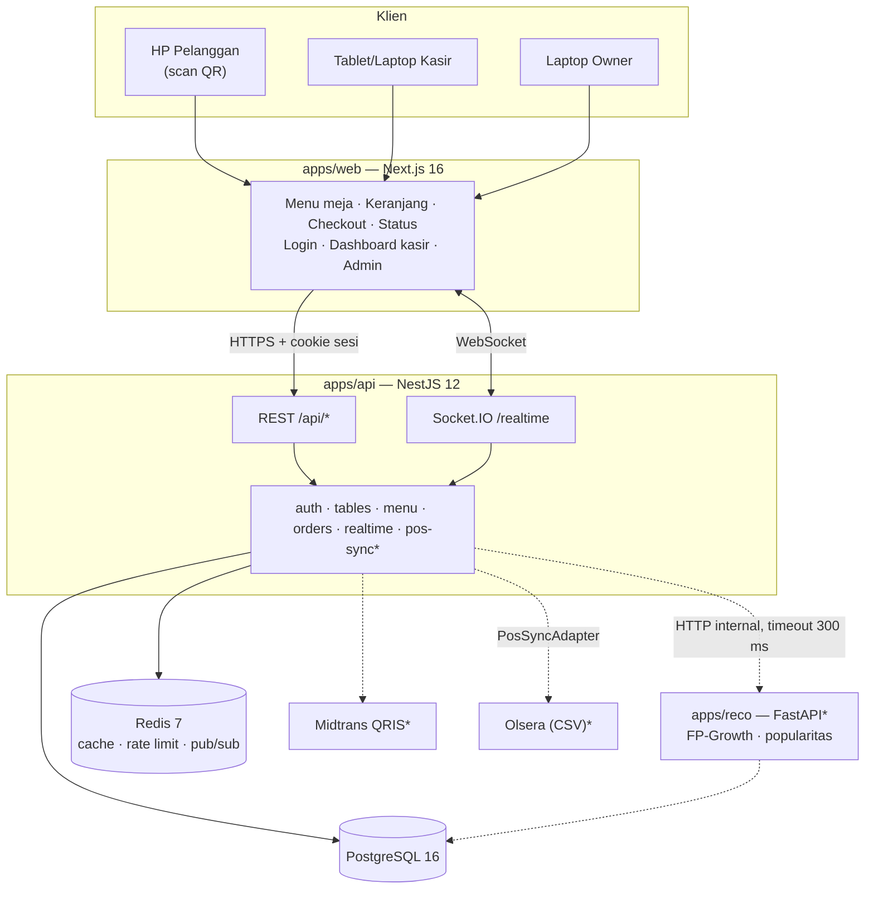
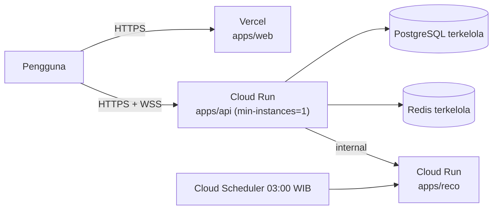
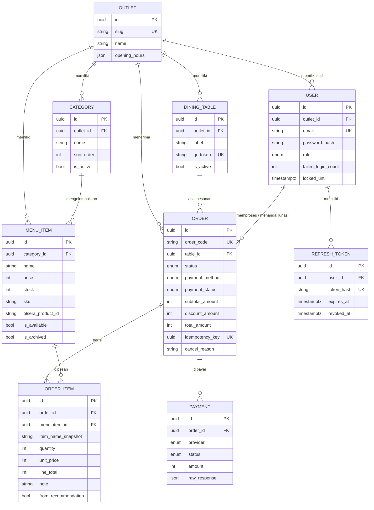
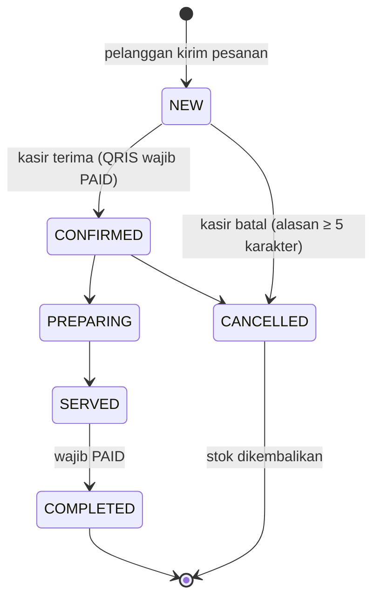
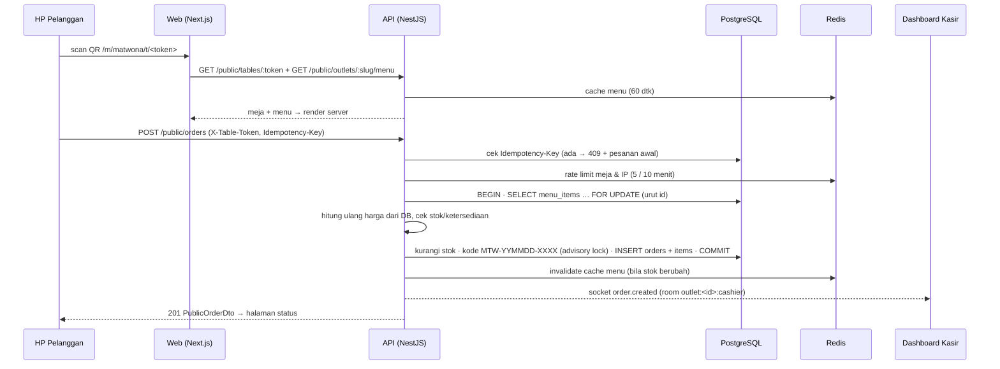
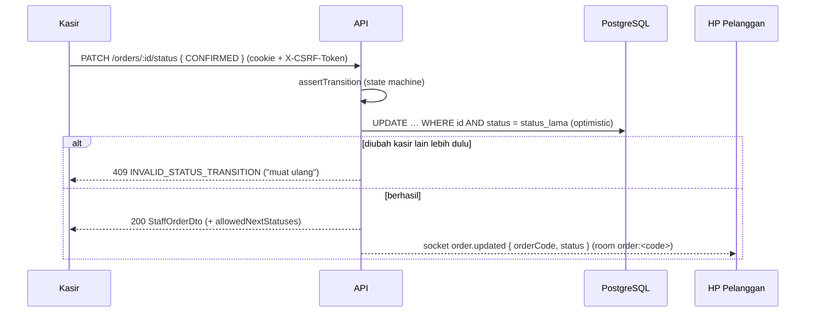
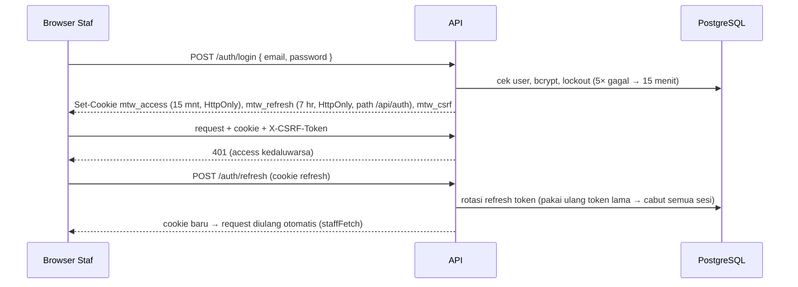

# Software Design Description (SDD) — Matwona Smart Order

> **Status:** Draft v0.1 untuk penilaian minggu 9 (MVP Review) · **Tanggal:** 31 Oktober 2026
> **Sumber:** `docs/PRD.md` (Bagian 3 & 4), `docs/adr/0001–0003`, kode di repositori (kondisi `main` per 31 Oktober 2026).
>
> Penanda status di dokumen ini:
> **[Terimplementasi]** sudah ada di kode & teruji · **[Direncanakan]** desain final, implementasi di sprint berikutnya · **[Terbuka]** menunggu keputusan/data.

---

## 1. Pendahuluan

### 1.1 Tujuan Dokumen

Dokumen ini menjelaskan rancangan teknis Matwona Smart Order: arsitektur, modul, data, antarmuka API, alur proses, model AI, keamanan, dan antarmuka pengguna. Dokumen menjadi acuan implementasi tim dan bukti komponen penilaian **SDD (Technical Document)** Computing Project.

### 1.2 Ruang Lingkup Sistem

Matwona Smart Order adalah sistem pemesanan digital berbasis QR meja untuk rumah makan Matwona (spesialis tuna & ayam kampung, 1 outlet, Bandung):

- **Pelanggan** memindai QR di meja, melihat menu, memesan tanpa akun, dan memantau status pesanan secara realtime.
- **Kasir** menerima pesanan baru secara realtime, memproses status, menandai lunas, dan membatalkan dengan alasan.
- **Owner/Admin** mengelola menu, meja & QR, serta (rencana) promo, sinkronisasi Olsera, analitik, dan rekomendasi AI.

Di luar ruang lingkup v1: akun pelanggan, Kitchen Display System, multi-outlet, program loyalitas.

### 1.3 Istilah

| Istilah | Arti |
|---|---|
| Token meja | String acak 128-bit (base62, 22 karakter) di URL QR; identitas meja tanpa login |
| Kode pesanan | `MTW-YYMMDD-XXXX` (tanggal WIB, nomor urut harian) |
| Olsera | POS yang dipakai mitra; sumber kebenaran master data menu |
| Room | Kanal Socket.IO tujuan event (kasir per outlet, atau per pesanan) |
| Idempotency-Key | UUID dari klien agar kirim ulang tidak membuat pesanan ganda |

---

## 2. Arsitektur Sistem

### 2.1 Gambaran Arsitektur



`*` = **[Direncanakan]** (Sprint 2–3). Garis putus-putus = integrasi yang belum aktif.

Prinsip utama:

1. **Monorepo pnpm** (`apps/web`, `apps/api`, `apps/reco`, `packages/shared`). Skema validasi Zod, tipe DTO, enum, dan kode error dipakai bersama web ↔ API sehingga kontrak tidak menyimpang (ADR 0001).
2. **Server sebagai sumber kebenaran.** Harga, total, stok, dan aturan transisi status hanya diputuskan API (NFR-007). Web hanya menampilkan dan meneruskan.
3. **Layanan stateless** (NFR-015). Status sesi di cookie + database; event realtime lintas instance lewat Redis adapter.
4. **Toleran kegagalan.** Redis mati → cache dilewati, rate limit memakai counter in-memory, Socket.IO memakai adapter in-memory. AI service mati → fallback "menu terlaris" (NFR-020, **[Direncanakan]**).

### 2.2 Teknologi & Justifikasi

| Lapisan | Teknologi | Alasan (ringkas ADR 0001) |
|---|---|---|
| Web | Next.js 16 (App Router), React 19, Tailwind CSS v4, TanStack Query, Zustand | Server Component untuk menu cepat (NFR-001), client component hanya untuk interaksi; satu bahasa (TypeScript) dengan API |
| API | NestJS 12 (ESM), Prisma 7 + PostgreSQL, Redis (ioredis), Socket.IO | Modul terstruktur (mudah dipetakan ke SDD), dukungan WebSocket persisten (tidak cocok di serverless), transaksi DB interaktif |
| Bersama | `packages/shared` (Zod 4) | Validasi identik di form web & API |
| AI | Python 3.12, FastAPI, pandas, mlxtend | Pustaka FP-Growth & evaluasi paling matang di Python (ADR 0003) |
| Uji | Vitest, Testing Library, Supertest, Playwright | Unit, komponen, e2e API, dan pemeriksaan UI mobile |
| CI | GitHub Actions | Lint, typecheck, unit test, e2e API (Postgres + Redis), ruff + pytest |

### 2.3 Arsitektur Deployment **[Direncanakan — S1-13]**



**[Terbuka]** Cookie sesi staf memakai `SameSite=Lax`, sehingga web dan API harus berada di **satu domain induk** (mis. `app.matwona.id` + `api.matwona.id`, `COOKIE_DOMAIN=.matwona.id`). Domain bawaan `*.vercel.app` + `*.run.app` membuat login staf dan handshake realtime kasir gagal. Keputusan domain diperlukan sebelum deploy staging.

### 2.4 Keputusan Desain Penting

| Keputusan | Alasan |
|---|---|
| Olsera diakses hanya lewat interface `PosSyncAdapter`; adapter aktif CSV (ADR 0002) | API Olsera belum tersedia; mengganti ke API cukup satu kelas |
| Rekomendasi: FP-Growth + popularitas per slot waktu (ADR 0003) | Pelanggan tamu (tanpa riwayat per orang); mudah dijelaskan & dievaluasi |
| Aturan transisi status pesanan hanya di `order-status.machine.ts`; API mengirim `allowedNextStatuses` ke UI | Satu sumber aturan; UI kasir tidak menduplikasi logika |
| Pesanan ganda (Idempotency-Key sama) dijawab **409 `DUPLICATE_REQUEST` + `details.order`** (PRD 4.5), klien menganggapnya sukses | Mengikuti kontrak PRD; kirim ulang setelah koneksi putus tetap aman |
| `expectedUnitPrice` opsional per item di payload pesanan | Satu-satunya cara mendeteksi `PRICE_CHANGED`; total tetap dihitung dari harga DB |
| `POST /auth/logout` publik (menyimpang dari PRD 4.3) **[Terbuka]** | Logout tetap bisa mencabut refresh token walau access token kedaluwarsa; menunggu kesepakatan tim |
| Room pelanggan hanya menerima `{ orderCode, status }` | Data pribadi (nama, no. HP) tidak dikirim ke kanal publik |
| Uji di HP tanpa ubah konfigurasi: URL `localhost` di web diganti host halaman saat `next dev`, CORS menerima `192.168.*.*:3000` di luar produksi | Wi-Fi uji mengisolasi klien; diuji agar produksi tidak terpengaruh |

---

## 3. Desain Komponen / Modul

### 3.1 Modul API (`apps/api/src/modules`)

| Modul | Tanggung jawab | Antarmuka | Status |
|---|---|---|---|
| `auth` | Login, refresh dengan rotasi, logout, `me`; lockout 5× gagal; guard global JWT → Roles → CSRF | `/auth/*` | [Terimplementasi] FR-009 |
| `tables` | Validasi token QR, CRUD meja, ganti token, PDF QR (`qrcode` + `pdfkit`) | `/public/tables/:token`, `/tables`, `/tables/:id/regenerate-token`, `/tables/qr.pdf` | [Terimplementasi] FR-001, FR-011 |
| `menu` | Menu publik dengan cache Redis 60 dtk, CRUD kategori & item, ketersediaan, arsip | `/public/outlets/:slug/menu`, `/categories`, `/menu-items` | [Terimplementasi] FR-002, FR-010 |
| `orders` | Pesanan tamu (idempotency, harga ulang, kunci stok, rate limit), status pesanan pelanggan, aksi kasir (status, lunas, batal + stok kembali) | `/public/orders`, `/public/orders/:code`, `/orders/*` | [Terimplementasi] FR-004, 006, 007, 008 |
| `realtime` | Gateway Socket.IO `/realtime`, autentikasi handshake, pemancar event | namespace `/realtime` | [Terimplementasi] FR-007, FR-008 |
| `pos-sync` | `PosSyncAdapter`, `OlseraCsvAdapter`, `MockOlseraAdapter` | `/pos-sync/*` | Kerangka ada; [Direncanakan] S2-07–S2-10 |
| `payments` | Midtrans Snap QRIS, webhook bertanda tangan | `/public/orders/:code/pay`, `/payments/midtrans/notification` | [Direncanakan] S2-01–S2-03 |
| `promos`, `analytics`, `recommendations`, `users` | Promo otomatis, agregasi penjualan, proxy AI & event, akun staf | lihat PRD 4.3 | [Direncanakan] S2–S3 |

Infrastruktur bersama: `common/` (`AppException`, filter error global, `ZodValidationPipe`, CORS), `prisma/` (`PrismaService` dengan adapter pg), `redis/` (`CacheService`, `RateLimitService`).

### 3.2 Arsitektur Web (`apps/web/src`)

| Rute | Pengguna | Render | Status |
|---|---|---|---|
| `/m/[outlet]/t/[token]` | Pelanggan | Server (data meja + menu) → client `MenuView` | [Terimplementasi] |
| `/m/[outlet]/t/[token]/checkout` | Pelanggan | Server (validasi ulang) → client `CheckoutView` | [Terimplementasi] |
| `/m/[outlet]/order/[code]` | Pelanggan | Client (token dari localStorage + realtime) | [Terimplementasi] |
| `/login` | Staf | Client | [Terimplementasi] |
| `/cashier` | Kasir/Admin | Client (realtime) | [Terimplementasi] |
| `/admin`, `/admin/menu`, `/admin/tables` | Admin | Client | [Terimplementasi] |
| `/` (landing) | Publik | SSG/ISR | [Direncanakan] S2-06 |

Pengelolaan state:

- **Data server:** TanStack Query (cache, refetch, polling saat realtime putus); event Socket.IO memperbarui cache langsung.
- **Keranjang:** Zustand dipersist ke `localStorage` per token meja, dimuat setelah mount (`skipHydration`) agar tidak ada hydration mismatch.
- **Pesanan pelanggan:** kode pesanan + token meja disimpan di `localStorage` (untuk halaman status & banner "Lihat pesanan aktif").
- **Sesi staf:** cookie HttpOnly milik API; `staffFetch` memperbarui sesi otomatis saat 401.

### 3.3 Paket Bersama (`packages/shared`)

Skema Zod (`createOrderSchema`, `menuItemSchema`, `createTablesSchema`, `loginSchema`, dst.), tipe DTO (`PublicOrderDto`, `StaffOrderDto`, `PublicMenu`, …), enum & label status berbahasa Indonesia, `ErrorCode` + pemetaan HTTP status, `formatRupiah`, nama event & room Socket.IO.

---

## 4. Desain Data

### 4.1 ERD (inti yang terimplementasi)



Tabel yang sudah ada di skema tetapi dipakai sprint berikutnya: `promos`, `promo_items` (S3-08), `pos_sync_logs`, `pos_column_mappings` (S2-07–S2-10), `recommendation_rules`, `recommendation_models`, `recommendation_events` (S3).

### 4.2 Aturan Data

| Aturan | Implementasi |
|---|---|
| Uang = integer Rupiah | Semua kolom nominal `INTEGER`; tidak ada float/decimal |
| Waktu disimpan UTC, ditampilkan WIB | `timestamptz`; tanggal bisnis (kode pesanan, filter kasir) memakai WIB (UTC+7) |
| Siap multi-outlet (NFR-016) | Semua tabel bisnis punya `outlet_id`; setiap query staf difilter outlet staf |
| Menu tidak dihapus permanen | `DELETE /menu-items/:id` → `is_archived = true` |
| Nama & harga tercatat saat pesan | `order_items.item_name_snapshot`, `unit_price` (histori tidak berubah bila menu diubah) |
| Penamaan | Tabel `snake_case` jamak, field Prisma `camelCase`, PK UUID |

### 4.3 State Machine Pesanan



Status pembayaran terpisah: `UNPAID` (bayar di kasir) → `PAID` (kasir "Tandai lunas"); QRIS: `PENDING` → `PAID` / `FAILED` / `EXPIRED` (webhook, [Direncanakan]). Satu-satunya tempat aturan: `apps/api/src/modules/orders/order-status.machine.ts`.

---

## 5. Desain Antarmuka API

- Base URL `/api`; health check `GET /health`.
- Format sukses `{ "success": true, "data": … }`; error `{ "success": false, "error": { code, message, details?, traceId } }` dengan pesan berbahasa Indonesia yang aman ditampilkan.
- Kode error terdaftar di `packages/shared/src/error-codes.ts` (mis. `ITEM_UNAVAILABLE` 409, `PRICE_CHANGED` 409, `INVALID_STATUS_TRANSITION` 409, `RATE_LIMITED` 429).
- Daftar lengkap endpoint, status implementasi, dan catatan per endpoint: **`docs/API.md`** (sumber kerja yang diperbarui setiap PR).

Ringkasan endpoint terimplementasi:

| Kelompok | Endpoint | Akses |
|---|---|---|
| Auth | `POST /auth/login`, `/auth/refresh`, `/auth/logout`, `GET /auth/me` | publik / staf |
| Publik | `GET /public/tables/:token`, `GET /public/outlets/:slug/menu`, `POST /public/orders`, `GET /public/orders/:code` | publik / token meja |
| Pesanan kasir | `GET /orders`, `GET /orders/:id`, `PATCH /orders/:id/status`, `POST /orders/:id/mark-paid`, `POST /orders/:id/cancel` | CASHIER, ADMIN |
| Menu | `/categories` (CRUD, reorder), `/menu-items` (CRUD, availability, arsip) | ADMIN (availability juga CASHIER) |
| Meja | `/tables` (CRUD), `POST /tables/:id/regenerate-token`, `GET /tables/qr.pdf` | ADMIN |
| Realtime | Socket.IO `/realtime`: `order.created`, `order.updated`, `payment.updated` | staf (cookie) / pelanggan (token meja + kode) |

Contoh `POST /public/orders` (header `X-Table-Token`, `Idempotency-Key`):

```json
{
  "customerName": "Rina",
  "customerPhone": "081234567890",
  "paymentMethod": "CASHIER",
  "items": [{ "menuItemId": "…", "quantity": 2, "note": "sambal dipisah", "expectedUnitPrice": 45000 }]
}
```

Respons `201`: `PublicOrderDto` (`orderCode`, `table`, `status: "NEW"`, `paymentStatus: "UNPAID"`, `subtotalAmount`, `discountAmount`, `totalAmount`, `items[]`, `createdAt`).

---

## 6. Desain Alur / Proses

### 6.1 Pembuatan Pesanan & Notifikasi Kasir [Terimplementasi]



Hasil uji end-to-end (Playwright, 31 Okt 2026): pesanan dari HP muncul di kolom "Baru" dashboard kasir dalam **221 ms** (target NFR-002 ≤ 2 detik). Uji konkurensi: 3 meja memperebutkan stok terakhir → tepat 1 berhasil, stok tidak minus; 3 request paralel dengan Idempotency-Key sama → tepat 1 pesanan.

### 6.2 Proses Pesanan oleh Kasir [Terimplementasi]



Pembatalan memakai pola yang sama dan mengembalikan stok dalam transaksi yang sama, sehingga dua kasir yang membatalkan bersamaan tidak mengembalikan stok dua kali (teruji e2e). Latensi kasir → HP pelanggan teruji **29–98 ms**.

### 6.3 Autentikasi Staf [Terimplementasi]



### 6.4 Pembayaran QRIS [Direncanakan — S2-01–S2-03]

Mengikuti PRD 3.4.1: `POST /public/orders/:code/pay` membuat transaksi Midtrans Snap (expiry 15 menit) → webhook `POST /payments/midtrans/notification` diverifikasi `SHA512(order_id + status_code + gross_amount + SERVER_KEY)` dan idempoten → `payment.updated` ke kasir & pelanggan; `expire`/`cancel` mengembalikan stok dengan pola `restoreStock` yang sama dengan pembatalan kasir.

### 6.5 Sinkronisasi Olsera [Direncanakan — S2-07–S2-10]

Admin unggah file export produk → pemetaan kolom (tersimpan di `pos_column_mappings`) → pratinjau perubahan → terapkan (upsert berdasarkan `olsera_product_id`/SKU, item hilang ditandai bukan dihapus) → `PublicMenuService.invalidate`. Ekspor transaksi lunas ke CSV untuk rekonsiliasi; riwayat transaksi Olsera diimpor sebagai `source = OLSERA_IMPORT` untuk analitik & AI. **[Terbuka]** menunggu contoh file export dari mitra (S0-08).

---

## 7. Desain Model AI [Direncanakan — S3-01–S3-04]

| Aspek | Rancangan (ADR 0003) |
|---|---|
| Data | `order_items` dikelompokkan per pesanan (riwayat Olsera + pesanan digital), 180 hari terakhir |
| Pra-proses | Pembersihan item arsip/tidak dikenal, one-hot encoding keranjang |
| Algoritma 1 | FP-Growth (`mlxtend`) + association rules: `min_support=0.01`, `min_confidence=0.2`, `lift>1` (di-tuning setelah EDA) → "Sering dibeli bersama" |
| Algoritma 2 | Popularitas per slot waktu (pagi/siang/sore/malam, 30 hari) → "Populer sekarang" & fallback cold start |
| Training | Batch harian 03:00 WIB (Cloud Scheduler) + manual dari admin; hasil disimpan versioned di `recommendation_rules` |
| Penyajian | API memanggil `reco` dengan timeout 300 ms (NFR-004); gagal → "menu terlaris" (NFR-020) |
| Evaluasi offline | Holdout 20% transaksi terbaru: HitRate@3, Precision@3, coverage vs baseline terlaris |
| Evaluasi online | Impression, CTR, attach rate (≥ 10% target), selisih AOV (tabel `recommendation_events`) |

**[Terbuka]** PoC & EDA (S1-12) menunggu data transaksi Olsera dari mitra (S0-08). Payload pesanan sudah menyimpan `fromRecommendation` per item agar metrik online bisa dihitung sejak awal.

---

## 8. Desain Keamanan

| Ancaman / Kebutuhan | Kontrol | Status |
|---|---|---|
| Penyalahgunaan akun staf | bcrypt (cost 12), lockout 5× gagal 15 menit, JWT access 15 menit, refresh 7 hari dirotasi (hash di DB; pakai ulang → semua sesi dicabut) | [Terimplementasi] NFR-006 |
| Akses tidak berhak | Guard global `JwtAuthGuard → RolesGuard → CsrfGuard`; semua endpoint wajib login kecuali `@Public()`; query staf difilter `outlet_id` | [Terimplementasi] |
| CSRF pada cookie sesi | Double-submit cookie: `mtw_csrf` + header `X-CSRF-Token` pada request yang mengubah data | [Terimplementasi] |
| Manipulasi harga | Harga & total dihitung ulang dari DB; harga klien diabaikan | [Terimplementasi] NFR-007 |
| Pesanan ganda / spam | `Idempotency-Key` unik; rate limit 5 pesanan / 10 menit per meja & per IP (Redis, fallback in-memory; `trust proxy` untuk IP asli di Cloud Run) | [Terimplementasi] NFR-009 |
| Menebak QR | Token acak 128-bit base62; dapat diganti (`regenerate-token`), meja nonaktif ditolak | [Terimplementasi] NFR-010 |
| Kebocoran data pelanggan | Room pelanggan tanpa data pribadi; status pesanan hanya dengan kode + token meja yang cocok; data pelanggan minimal (nama, HP opsional); no. HP disamarkan di dashboard kasir (`0812****7890`, `maskPhone`) | [Terimplementasi] NFR-011 |
| Header & transport | Helmet, CORS hanya `WEB_ORIGIN` (+ LAN hanya di luar produksi), cookie `Secure` di produksi | [Terimplementasi] / HTTPS saat deploy |
| Webhook palsu | Verifikasi signature SHA512 + idempoten | [Direncanakan] NFR-008 |
| Audit keamanan | OWASP ZAP baseline, `pnpm audit`, `pip-audit` | [Direncanakan] S4-03 |

---

## 9. Desain Antarmuka Pengguna

- **Mockup (S0-06):** 20 artboard di kanvas Claude Design (design system, menu pelanggan C1–C7, landing L1–L2, kasir K1–K3, admin A1–A7; tautan di `docs/design/BRAND.md`). Penyelarasan kode dilacak di task S2-13.
- **Brand:** token warna di `apps/web/src/app/globals.css` (primary `#106f4d`, accent `#069d70`, cream `#ffffca`, ink `#1f2a24`, danger `#c0392b`, palet badge status `success`/`warning`/`info`/`neutral`/`danger` + `-soft`, `disabled`, placeholder foto per jenis menu, skala heading, radius & bayangan). Komponen hanya memakai kelas token (`docs/design/BRAND.md`). Font Mosvita belum tersedia → fallback Plus Jakarta Sans.
- **Aksesibilitas (NFR-014):** setiap pasangan teks/latar yang dipakai komponen diuji otomatis ≥ 4,5:1 (`contrast.test.ts`). Temuan: `accent`/`success` hanya 3,46:1 di atas putih → tidak dipakai untuk teks kecil.
- **Mobile-first (NFR-012):** lebar minimum 360 px, target sentuh ≥ 44 px; diperiksa otomatis dengan `pnpm --filter web ui:check` (Playwright: screenshot, overflow horizontal, target kecil, error console) dan di HP Android sungguhan.
- **Komponen dasar:** `Button` (varian primary/secondary/ghost/danger/danger-ghost/inverse), `Card` (padding none/sm/md), `Badge` (tone status), `Input`/`Textarea` (label, hint, error ber-ARIA, penghitung karakter), `BottomSheet` (dialog modal, fokus terjebak & dikembalikan, kunci scroll), `QuantityStepper`, `ProgressSteps` (mendatar/vertikal), `Toast`, `EmptyState`, `ConnectionBanner`, `PhotoPlaceholder`, `Logo`. Katalog di `/dev/ui` (mode dev).
- **Layar utama terimplementasi:** menu meja (logo + chip meja, tab kategori sticky, pencarian, sheet detail menu, label Habis), keranjang (bottom sheet + bar melayang), checkout (kartu metode bayar), status pesanan realtime (timeline vertikal), QR tidak dikenali, login staf, dashboard kasir (4 kolom/tab, bunyi & toast pesanan baru), admin menu, admin meja & QR, PDF QR meja. Alur pelanggan, login, dan kasir sudah mengikuti mockup; admin menu & meja menyusul (S2-13 bagian 4).
- Screenshot setiap layar dapat dibuat ulang dengan `ui:check` untuk lampiran.

---

## 10. Strategi Pengujian & Kualitas

| Jenis | Alat | Cakupan saat ini |
|---|---|---|
| Unit & integrasi modul API | Vitest | 135 test; coverage baris 72% (orders 90%, tables 86%, auth 74%, menu 73%) |
| Unit & komponen web | Vitest + Testing Library (jsdom) | 155 test; coverage baris 85% |
| E2E API | Vitest + Supertest + Postgres + Redis + socket.io-client | 59 test: konkurensi stok, idempotency paralel, rate limit, transisi kasir, isolasi outlet, latensi realtime |
| UI mobile | Playwright (`ui:check`) + uji manual HP | 360 × 740 px, tanpa overflow/target < 44 px |
| CI | GitHub Actions | 3 job paralel per PR: `node`, `api-e2e`, `reco`; 16 PR di-merge melalui CI |

Target NFR-018 (coverage ≥ 60% pada modul inti) terpenuhi untuk `orders` dan `tables`. Uji performa (k6, Lighthouse) dan keamanan dijadwalkan di Sprint 4.

---

## 11. Keterlacakan Kebutuhan (Requirement → Desain → Uji)

| FR | Fitur | Modul / Komponen | Bukti uji |
|---|---|---|---|
| FR-001 | Scan QR meja | `tables.resolveToken`, `/m/[outlet]/t/[token]` | `tables.e2e-spec`, `load-table-menu.test`, Playwright |
| FR-002 | Menu digital | `PublicMenuService` (cache), `MenuView` | `menu.e2e-spec`, `menu-view.test` |
| FR-003 | Keranjang | `stores/cart`, `CartSheet` | `cart.test`, `cart.test.tsx` |
| FR-004 | Checkout tamu | `OrdersService.create`, `CheckoutView` | `orders.e2e-spec`, `checkout-view.test` |
| FR-006 | Bayar di kasir | `StaffOrdersService.markPaid` | `staff-orders.e2e-spec` |
| FR-007 | Status pesanan | `GET /public/orders/:code`, room `order:<code>`, `OrderStatusView` | `realtime.e2e-spec`, `order-status-view.test` |
| FR-008 | Dashboard kasir realtime | `StaffOrdersService`, `RealtimeService`, `CashierDashboard` | `staff-orders.e2e-spec`, `realtime.e2e-spec`, `cashier-dashboard.test` |
| FR-009 | Autentikasi staf | modul `auth`, `/login`, `useStaffSession` | `auth.e2e-spec`, `login-form.test` |
| FR-010 | Manajemen menu | `CategoriesService`, `MenuItemsService`, `MenuAdmin` | `menu.e2e-spec`, `menu-admin.test` |
| FR-011 | Meja & QR | `TablesService`, `qr-pdf.ts`, `TablesAdmin` | `tables.e2e-spec`, `qr-pdf.spec`, `tables-admin.test` |
| FR-005, 012–022 | QRIS, landing, Olsera, AI, analitik, promo, staf | — | [Direncanakan] |

---

## 12. Hal Terbuka

| Item | Dampak | Pemilik |
|---|---|---|
| Keputusan domain staging/production | Login staf & realtime kasir di staging | Tim / PM |
| Data export Olsera (S0-08) | Impor menu, analitik, PoC & model AI | PM (mitra) |
| Logo SVG resmi (mockup S0-06 sudah ada di kanvas Claude Design; logo saat ini PNG dari kanvas) | Ketajaman logo di PDF QR & layar besar | FE1 (mitra) |
| Logout publik vs PRD 4.3 | Konsistensi dokumen | Tim |
| Event `menu.updated` (menu habis langsung berubah di HP pelanggan) | UX; belum ada task | Tim |
